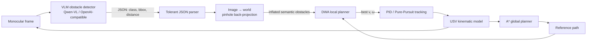
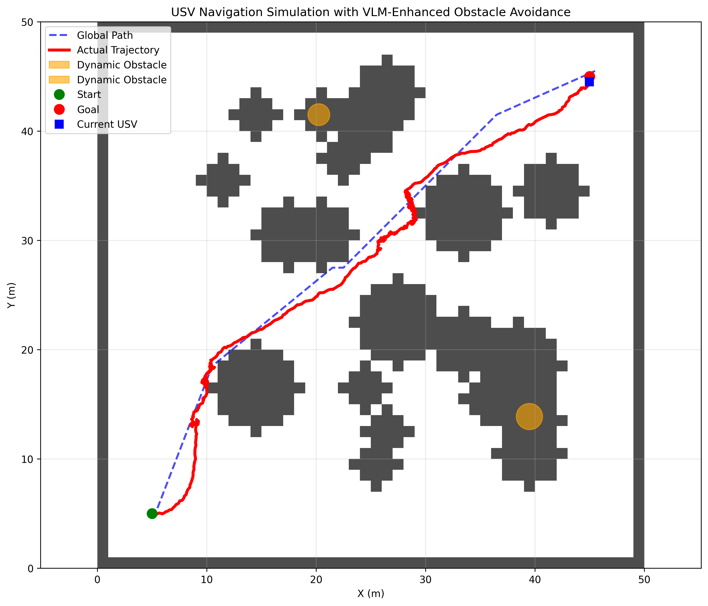
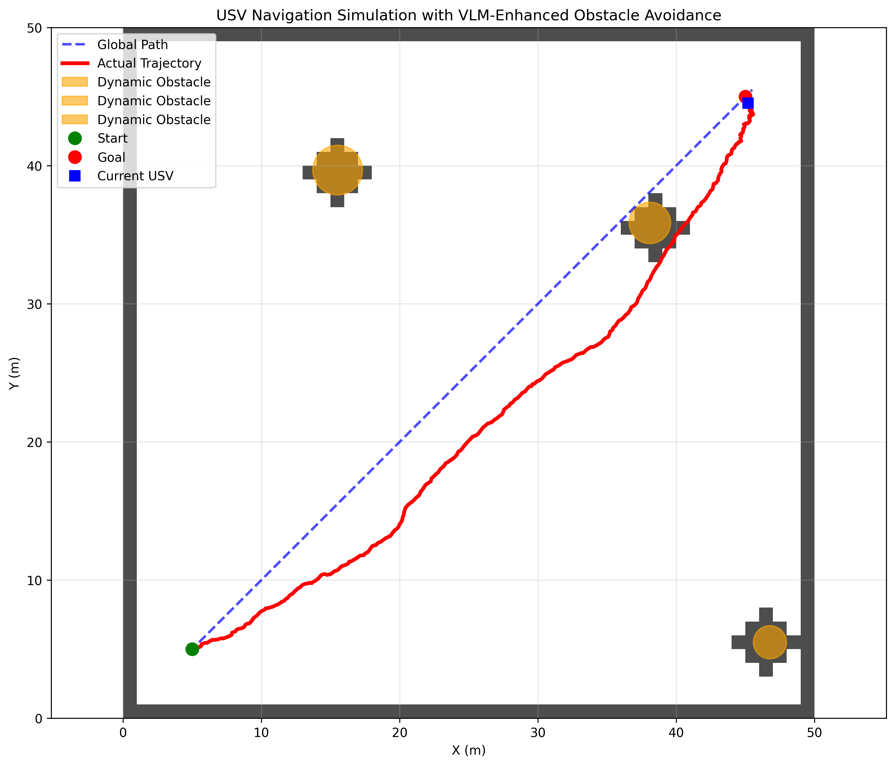

# USV Autonomous Obstacle Avoidance · VLM + A\* + DWA + PID

**English** | [简体中文](README.md)


> A closed-loop autonomy stack for an unmanned surface vehicle (USV) that replaces
> LiDAR/radar perception with a **vision-language model**. A single monocular frame goes
> into Qwen-VL, structured obstacle descriptions come out, and they are injected into the
> **DWA** cost function — so the vehicle does not merely avoid "something over there",
> it avoids it *with semantics*.

## Why

A classic `point cloud → occupancy grid → DWA` pipeline is reliable but semantically blind:
it knows an obstacle exists, not whether it is a buoy, a fishing boat, or a wave crest.
Those three require very different safety margins.

This project focuses on the hard part of that idea — **how to feed a slow, noisy,
non-deterministic VLM into a 10 Hz motion-planning loop safely**:

- The VLM only contributes *semantics and relative bearing*; it never does precise localization.
- Depth error is absorbed by class-dependent **inflation** (`1.6×` radius + `0.4 m` margin)
  instead of being trusted directly.
- Semantic obstacles and geometric grid obstacles share the **same distance field** inside
  the DWA obstacle cost, so nothing bypasses the safety layer.
- If no API key is configured the perception layer degrades to simulated detections and the
  whole planning/control chain still runs — external model dependency stays decoupled from
  the core algorithm.

## Architecture



## Modules

| Module | File | Responsibility |
| --- | --- | --- |
| Perception | `src/perception/vlm_detector.py` | Base64 upload, JSON-schema-constrained prompt, fault-tolerant parsing, result cache |
| Projection | same | Pinhole back-projection with known FOV/height, truncated at `VLM_CAMERA_RANGE=12 m` |
| Global planning | `src/planning/global_planner.py` | 8-connected grid A\*, hard obstacle penalty, path smoothing with line-of-sight check |
| Local planning | `src/planning/local_planner.py` | Acceleration-constrained dynamic window, 3 s rollout, 4-term cost |
| Control | `src/control/pid_controller.py` | PID, Pure-Pursuit, Stanley, DWA tracking |
| Simulation | `src/simulation/vrx_simulator.py` | USV kinematics, dynamic obstacles, 4 scenarios |
| Synthetic data | `src/simulation/realistic_image_generator.py` | Weather/time-of-day marine imagery for offline VLM validation |
| Experiments | `src/experiments/dynamic_avoidance_test.py` | VLM on/off A-B test, progressive obstacle density test |

DWA cost:

```python
total = 8.0 * obstacle_cost + 3.0 * to_goal_cost + 1.2 * path_adherence_cost + 0.1 * speed_cost
```

`obstacle_cost` consumes both the occupancy grid and the VLM-derived semantic obstacles.

## Quick start

```bash
git clone https://github.com/DOUFUQAQ/usv-obstacle-avoidance.git
cd usv-obstacle-avoidance
pip install -r requirements.txt

export OPENAI_API_KEY="your-key"                       # optional
export OPENAI_BASE_URL="https://dashscope.aliyuncs.com/compatible-mode/v1"

python main.py --mode demo          # basic static scenario, writes demo_result.png
python main.py --mode dynamic       # moving obstacles
python main.py --mode experiment    # full experiment incl. VLM A-B comparison
python main.py --mode performance   # 10 random goals: success rate + planning latency
python main.py --mode test-vlm      # VLM connectivity + detection quality only
python main.py --mode demo --no-vlm # geometric DWA baseline
```

| Static scenario | Dynamic obstacles |
| --- | --- |
|  |  |

Black dots: rasterized static obstacles · red circles: VLM/dynamic obstacles ·
blue: A\* reference path · green: executed DWA trajectory.

## Tests

37 unit tests covering A\* solvability and obstacle avoidance, DWA dynamic-window and
safety-clearance behaviour, PID convergence, the image→world projection, and fault-tolerant
parsing of VLM responses (recorded payloads — no network access).

```bash
python -m unittest discover -s tests -t .   # stdlib only, needs numpy
# or
python -m pytest -q
```

`matplotlib`, `opencv` and `requests` are deliberately **optional imports**: a caller that only
needs planning or response parsing (and CI) does not have to install a GUI or a HTTP stack, so
the core logic is verifiable on plain CPU, offline, in milliseconds.

## Known limitations

- **VLM latency** is 1–3 s versus a 10 Hz control loop. The current mitigation is caching and
  frequency reduction; the proper design is a low-frequency semantic map plus a high-frequency
  geometric fallback.
- **The simulator is a self-written grid environment**, not Gazebo/VRX rendering. Real
  deployment means replacing `Environment.generate_camera_image()`.
- **Distance estimates are coarse**, hence the deliberately conservative inflation factors.
- No online learning yet; class → inflation rules are static.

## Roadmap

- [ ] Gazebo / VRX integration
- [ ] Async VLM worker pool + time-decayed semantic map
- [ ] Multi-frame temporal consistency to suppress single-frame false positives
- [ ] Adaptive DWA weights based on obstacle density
- [ ] CI + expanded test suite (in progress)

## License

[MIT](LICENSE) © 2025 DOUFUQAQ
