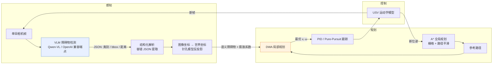
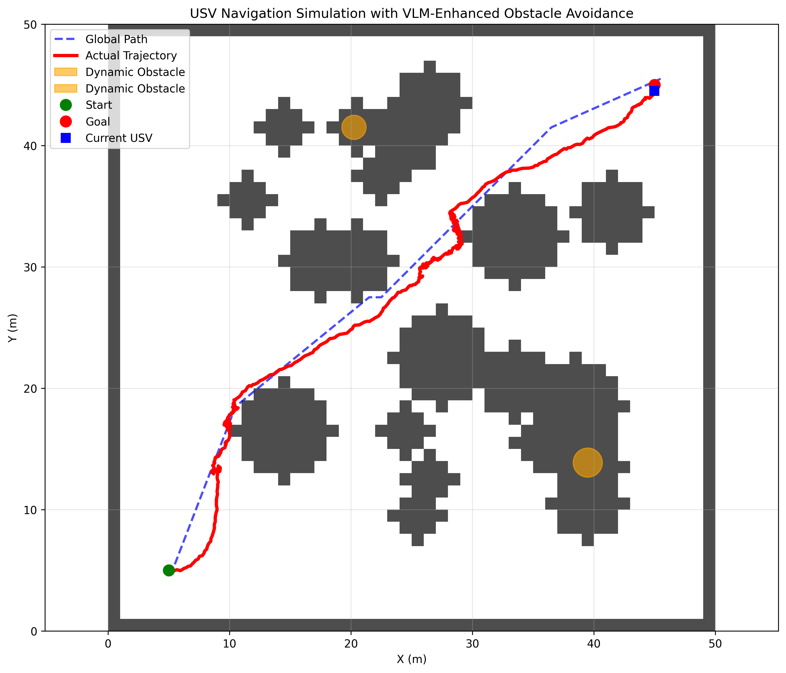
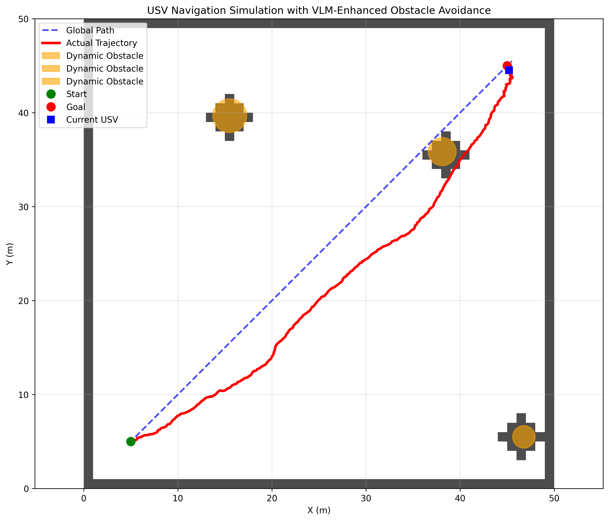

# USV 自主避障导航系统 · VLM + A\* + DWA + PID

[English](README.en.md) | **简体中文**


> 用**视觉语言模型**替换传统的激光 / 雷达感知，在无人水面艇（USV）上跑通
> **「感知 → 全局规划 → 局部避障 → 轨迹跟踪」**的完整闭环。
> 单目相机画面直接进 VLM，输出结构化障碍物信息，注入 DWA 代价函数，让避障从"躲开有东西的地方"变成"看懂了再躲"。

---

## 为什么要做这个

传统 USV 避障流水线是 `激光/毫米波点云 → 占据栅格 → DWA`。它可靠，但有一个根本缺陷：**只知道"这里有东西"，不知道"这是什么"**。

在实际水域里，这个差别很要命：

| 场景 | 传统占据栅格 | 本项目（VLM 语义感知） |
| --- | --- | --- |
| 前方浮标 | 障碍物，一律绕行 | 判定为低风险小目标，可贴边通过 |
| 前方渔船 | 障碍物 | 判定为高动态风险，提前 12 m 开始规避 |
| 水面反光 / 浪花 | 易误检为障碍 | 语义过滤，不触发避障 |
| 岸边礁石 | 障碍物 | 与"船"区分开，采用不同的安全半径 |

所以这个项目的核心不是又一个 DWA 实现，而是：**解决 VLM 的输出如何安全地进入实时运动规划闭环**。

---

## 系统架构



**闭环的关键点**在于 VLM 只做"语义与相对方位"，不做精确定位；世界坐标反投影误差用**膨胀系数**吃掉（`VLM_OBS_INFLATION_FACTOR=1.6` + `VLM_OBS_EXTRA_MARGIN=0.4m`），把不确定性换成都市安全裕度——这是把慢速、有噪声的模型塞进实时控制回路时最重要的一条工程取舍。

---

## 核心模块

| 模块 | 文件 | 职责 | 关键实现 |
| --- | --- | --- | --- |
| 感知 | `src/perception/vlm_detector.py` | 图像 → 障碍物列表 | Base64 编码上传、Prompt 约束 JSON schema、`_extract_json_content` 容错解析（兼容 ` ```json ` 包裹与前后废话）、结果缓存 |
| 坐标变换 | 同上 | 像素 → 世界坐标 | 已知相机水平 FOV + 安装高度，针孔模型反投影，`VLM_CAMERA_RANGE=12m` 截断 |
| 全局规划 | `src/planning/global_planner.py` | 栅格 A\* | 8 邻域、`ASTAR_OBSTACLE_COST=1000` 硬惩罚、路径平滑 + 视线可达性检查（`_is_line_clear`） |
| 局部规划 | `src/planning/local_planner.py` | 实时避障 | 加速度约束动态窗口采样、轨迹前推 3 s、四项代价加权 |
| 控制 | `src/control/pid_controller.py` | 轨迹跟踪 | PID + Pure-Pursuit + Stanley + DWA 跟踪四种控制器 |
| 仿真 | `src/simulation/vrx_simulator.py` | VRX 环境 | USV 运动学模型、动态障碍物、四种场景（basic / dynamic / complex / dense） |
| 合成数据 | `src/simulation/realistic_image_generator.py` | 海洋图像 | 按天气 / 时段生成海面、波浪、云、海鸟，用于离线验证 VLM 识别率 |
| 实验 | `src/experiments/dynamic_avoidance_test.py` | 评测 | VLM 开/关 A-B 对比、渐进式障碍测试、规划耗时趋势图 |

### DWA 代价函数

局部规划在动态窗口内采样 `(v, ω)`，每条预测轨迹按四项代价打分后取最小：

```python
total_cost = (DWA_OBSTACLE_COST_GAIN * obstacle_cost      # 8.0  与障碍物最近距离
            + DWA_TO_GOAL_COST_GAIN  * to_goal_cost        # 3.0  离目标距离
            + DWA_PATH_COST_GAIN     * path_adherence_cost # 1.2  贴合全局参考路径
            + DWA_SPEED_COST_GAIN    * speed_cost)         # 0.1  偏快
```

其中 `obstacle_cost` 的输入既有栅格地图里的静态障碍，也有 `integrate_vlm_obstacles()` 注入的 **VLM 语义障碍**——两类障碍共用同一个距离场，只是半径按语义类别做了差异化膨胀。这就是"语义"真正落地的地方，而不是仅停留在 prompt 里。

---

## 快速开始

```bash
git clone https://github.com/DOUFUQAQ/usv-obstacle-avoidance.git
cd usv-obstacle-avoidance
pip install -r requirements.txt

# VLM 走 OpenAI 兼容端点，默认对接阿里云 DashScope 的 Qwen-VL
export OPENAI_API_KEY="your-key"
export OPENAI_BASE_URL="https://dashscope.aliyuncs.com/compatible-mode/v1"
```

```bash
python main.py --mode demo          # 基础避障演示并出图
python main.py --mode dynamic       # 动态障碍物场景
python main.py --mode experiment    # 完整实验（含 VLM 对比）
python main.py --mode performance   # 10 次随机目标点的成功率 / 规划耗时
python main.py --mode test-vlm      # 只测 VLM 连通性与识别效果
python main.py --mode demo --no-vlm # 纯几何 DWA 对照组
```

> **没有 API Key 也能跑。** 感知层检测到密钥缺失会打印警告并回落到模拟障碍物，
> 规划与控制的完整链路仍然可复现——这是把外部模型依赖和核心算法解耦的直接好处。

跑完会在根目录生成 `demo_result.png` / `dynamic_demo_result.png`：

| 基础场景 | 动态障碍场景 |
| --- | --- |
|  |  |

上图为实际运行输出：黑点为栅格化静态障碍，红圈为 VLM/动态障碍，蓝线为 A\* 参考路径，绿线为 DWA 实际轨迹。

---

## 测试

37 个单元测试，覆盖 A\* 可解性与避障、DWA 动态窗口与安全清距、PID 收敛、
图像→世界坐标反投影、以及 VLM 返回值的容错 JSON 解析（用离线样本，不发网络请求）。

```bash
python -m unittest discover -s tests -t .   # 零额外依赖，只需要 numpy
# 或
python -m pytest -q
```

设计上刻意让 `matplotlib` / `opencv` / `requests` 变成**可选依赖**：只做规划和感知解析的
调用方（以及 CI）不需要装图形库和网络库，核心逻辑因此可以纯 CPU、离线、秒级验证。

---

## 项目结构

```
usv-obstacle-avoidance/
├── main.py                       # 统一 CLI 入口（5 种运行模式）
├── requirements.txt
├── src/
│   ├── perception/
│   │   └── vlm_detector.py       # VLM 检测 + 坐标反投影 + 结果缓存
│   ├── planning/
│   │   ├── global_planner.py     # A* + 路径平滑
│   │   └── local_planner.py      # DWA + 语义障碍注入
│   ├── control/
│   │   └── pid_controller.py     # PID / Pure-Pursuit / Stanley
│   ├── simulation/
│   │   ├── vrx_simulator.py      # USV 模型 + 场景 + 可视化
│   │   └── realistic_image_generator.py
│   ├── experiments/
│   │   └── dynamic_avoidance_test.py
│   └── utils/
│       └── config.py             # 全部可调参数集中在此
├── scripts/                      # 调试与连通性自检脚本
├── tests/                        # 单元测试
└── docs/
    ├── requirements.md           # 原始需求
    ├── project-summary.md        # 开发总结
    └── images/
```

所有可调参数（DWA 权重、膨胀系数、PID 增益、相机量程）都集中在 `src/utils/config.py`，调参不需要翻散落在各处的魔法数字。

---

## 实验与评测

`src/experiments/dynamic_avoidance_test.py` 提供两组实验：

1. **VLM 开/关 A-B 对比**：同一场景下比较到达率、碰撞次数、路径长度、平均规划耗时；
2. **渐进式障碍测试**：逐步增加障碍密度，观察成功率拐点——这是判断"算法什么时候开始失效"比单点指标更有意义。

规划耗时统计由 `DWALocalPlanner.get_planning_statistics()` 输出（平均 / 最大 / 采样点数），端到端实测数据请本地跑 `python main.py --mode performance` 复现，避免把某台机器的数字写死在文档里。

---

## 已知局限

写在这里而不是藏起来，因为边界比卖点更能说明工程判断：

- **VLM 延迟**：单次调用 1–3 s，远慢于 DWA 的 10 Hz 控制频率。当前用缓存 + 降频缓解，实时方案应当是"VLM 低频刷新语义地图 + 几何感知高频兜底"。
- **仿真环境是自建的栅格仿真器**，不依赖 Gazebo/VRX 真实渲染；接入真实 VRX 需要替换 `Environment.generate_camera_image()`。
- **距离估计噪声大**：VLM 给的是相对距离的粗估，所以整套参数偏向保守（膨胀系数 1.6）；精确距离仍需测距传感器。
- **未做在线学习**：障碍物语义类别目前写死在 prompt 与膨胀规则里，没有反馈闭环。

## Roadmap

- [ ] 接入 Gazebo / VRX 真实仿真栈，替换自建栅格环境
- [ ] VLM 异步线程池 + 语义地图时间衰减，把感知与控制彻底解耦
- [ ] 多帧时序一致性校验，抑制单帧误检
- [ ] DWA 参数在线自适应（按障碍密度调权重）
- [ ] 补全单元测试与 CI（进行中）

## License

[MIT](LICENSE) © 2025 DOUFUQAQ
